

  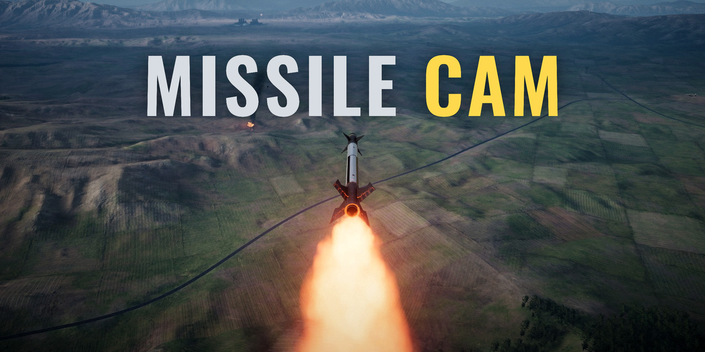

  <picture>
    <source media="(prefers-color-scheme: dark)" srcset="docs/media/logo-dark.png">
    
  </picture>

  <b>Ride your own missiles in Nuclear Option. Press one key and the camera follows the missile all the way to the hit.</b>

  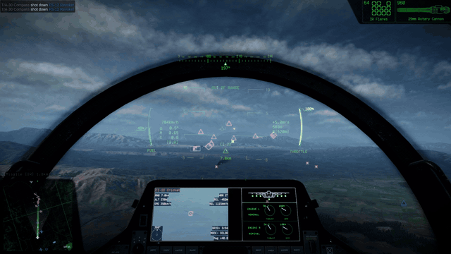

Missile Cam is a free mod for [Nuclear Option](https://store.steampowered.com/app/2168680/). It is
fan-made and not affiliated with Shockfront Studios.

**Status: test build.** Version 0.3.2 was tested in a single-player mission on Nuclear Option 0.34.2
(Linux, Proton) with a default BepInEx install and no other mods: missile follow, the move to the
next missile, target view and the key window all worked. It is not yet tested on Windows, in
multiplayer or in VR. Version 0.3.1 and earlier stopped working right after the game started on a
default BepInEx install; please update.

## What it does

- **Follows your missile.** Fire, press **]**, and the camera rides behind your missile until it hits
  or is gone.
- **Every missile in the air.** Press **]** again for your next missile in flight. After the last
  one, the next press takes you back to your aircraft.
- **Holds on the hit.** When the missile hits or is gone, the camera stays on the spot for 2.5
  seconds. Then it moves on to your next missile, or back to your aircraft.
- **Looks at your target.** Press **[** to watch your selected target, if your side has a good track
  on it, the same rule the game's map uses.
- **Your keys, your stick.** Change the keys and joystick buttons in a small window inside the game.
- **Only for you.** Nobody else needs the mod, and it sends nothing over the network.

Your aircraft keeps flying on your controls while you watch, just as it does in the game's own
orbit view.

## Gallery

Real game footage from the 0.3.2 test runs, colour graded. Nothing is added to the pictures except the
title on the cover.

| | |
|---|---|
|  | 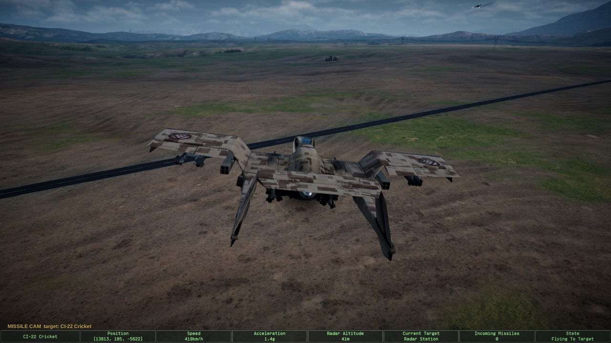 |
| The normal cockpit view, a moment before launch. | Press **[** to watch your target, here a CI-22 Cricket. |
| 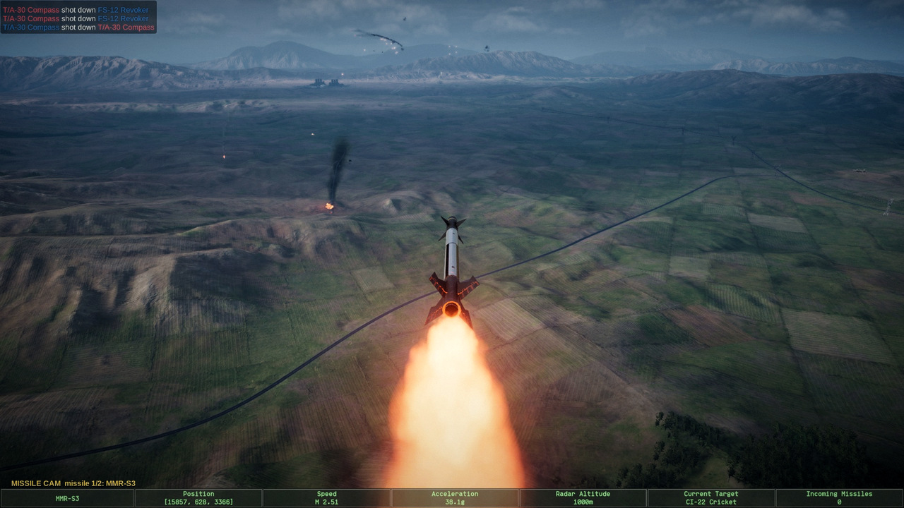 | 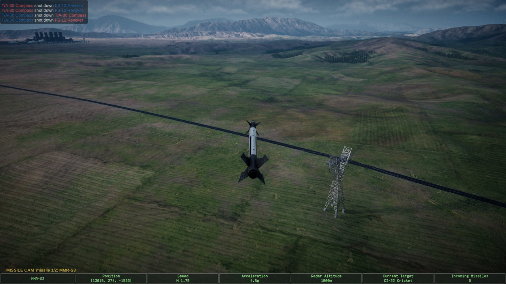 |
| Press **]** after launch and the camera rides behind the missile. | It stays with the missile all the way in. |
| 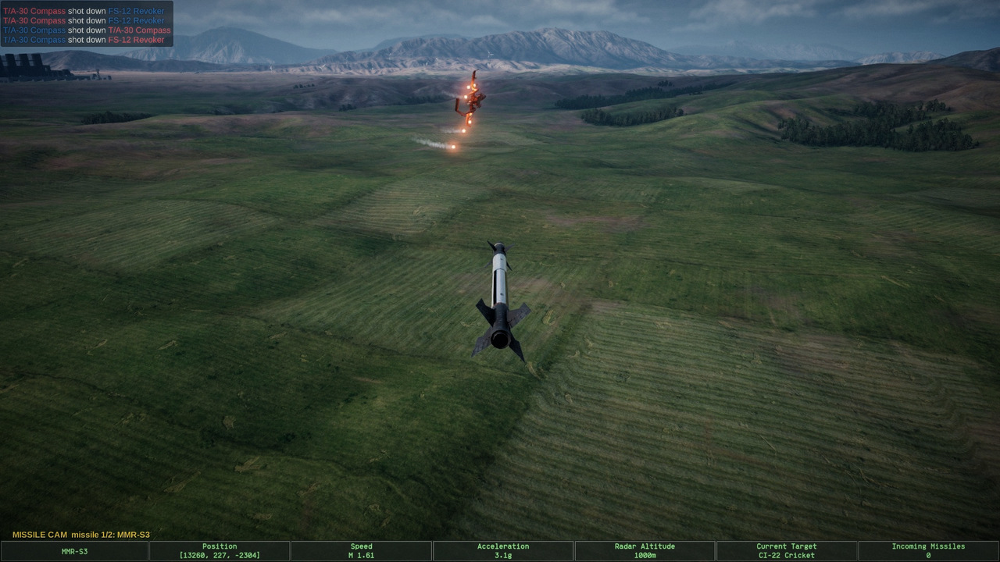 | 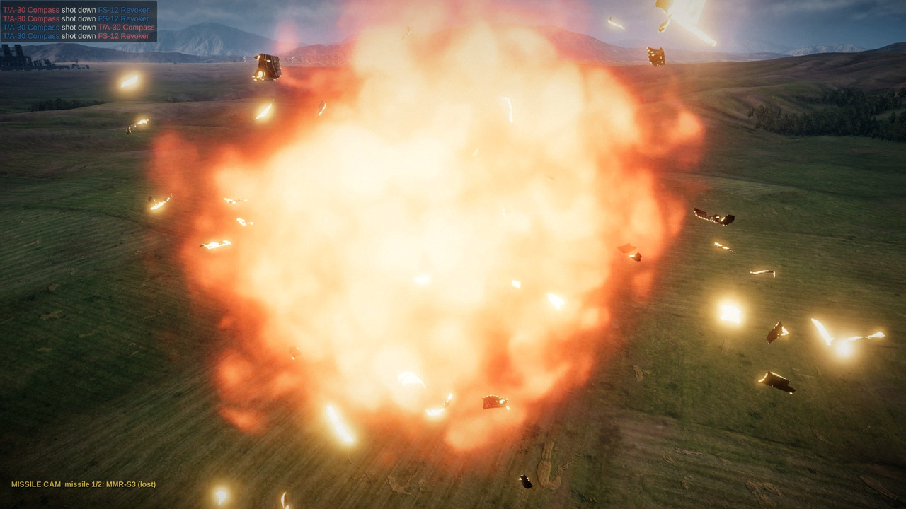 |
| Closing in. The target fires flares. | The hit. |
| 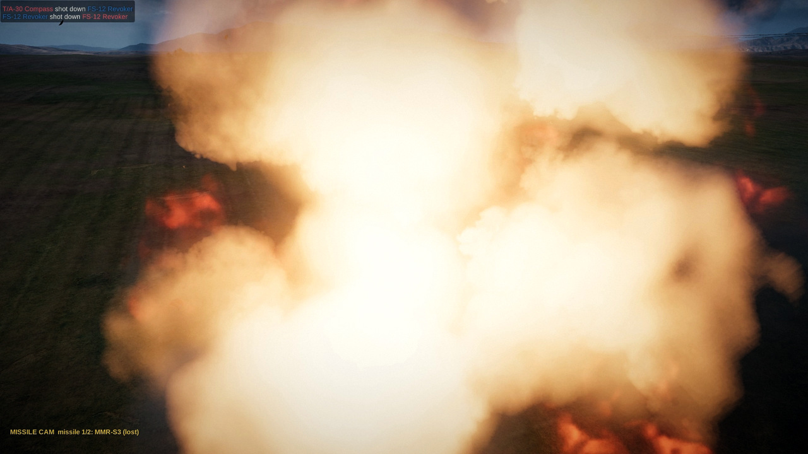 | 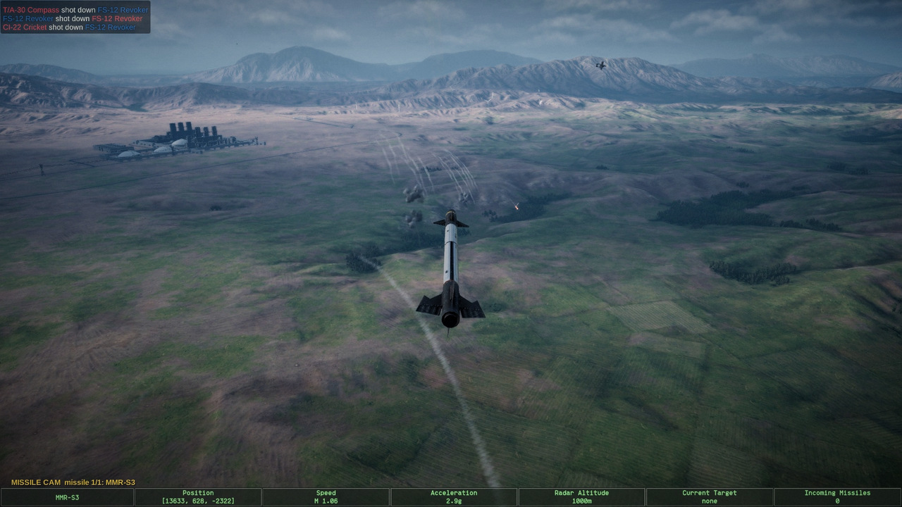 |
| The camera holds on the spot for 2.5 seconds. | Then it moves to your next missile in flight. |
| 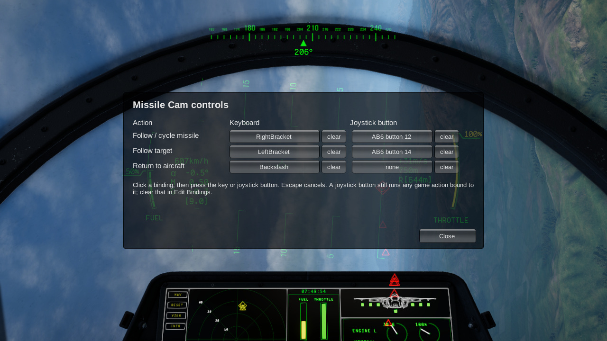 | 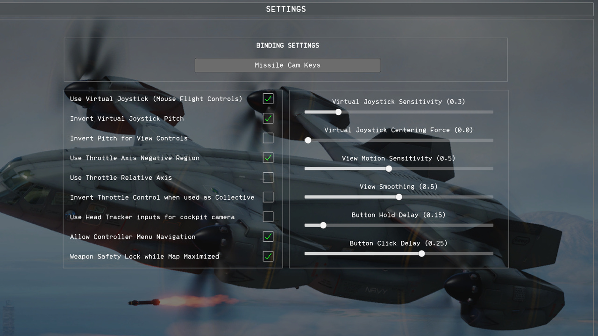 |
| **Ctrl+F8** opens the key window, in flight or in the menus. | Or click **Missile Cam Keys** in the game's Controls menu. |

## Install

You need Nuclear Option from Steam. To find the game folder, right-click Nuclear Option in your Steam
library and choose **Manage**, then **Browse local files**. It is the folder with
`NuclearOption.exe`.

1. Install [BepInEx 5](https://github.com/BepInEx/BepInEx/releases) (the x64 version for Windows,
   5.4.23 or a later 5.4) into the game folder, if it is not there yet. BepInEx is the mod loader
   most Nuclear Option mods use. Start the game once and quit, so BepInEx makes its folders. On
   Linux, also set this Steam launch option for the game first:
   `WINEDLLOVERRIDES="winhttp=n,b" %command%`
2. Download `NoMissileCam-<version>.zip` from
   [Releases](https://github.com/Talamander/no-missile-cam/releases).
3. Unzip it into the game folder. You should now have
   `BepInEx/plugins/NoMissileCam/NoMissileCam.dll`.
4. Start the game. The Controls menu now has a **Missile Cam Keys** button.

To update, close the game and unzip the new version over the old one.

If you already use other BepInEx mods, they keep working. Missile Cam only adds its own folder.

## Keys

| Key | What it does |
|---|---|
| ] | Follow your first missile in flight. Press again for the next one. After the last, back to your aircraft. |
| [ | Follow your selected target, if your side has a good track on it. Press again to go back. |
| \ | Back to your aircraft and the view you had before. |
| Ctrl+F8 | Open the key window. |

The missile and target keys also have joystick buttons, set by default for the MOZA AB6 (buttons 12
and 14). With any other stick they do nothing until you set your own.

### Change the keys

Open the game's **Controls** menu and click **Missile Cam Keys**, or press **Ctrl+F8** anywhere.
Click a binding, then press the new key or joystick button. Escape cancels, and **clear** removes a
binding. Each action can have one key (with Shift, Ctrl or Alt if you hold them) and one joystick
button. Changes save at once.

If a joystick button also does something in the game, both happen. To stop that, clear the game's
own binding on that button in the Controls menu.

All settings, including how long the camera holds after a hit, are in
`BepInEx/config/talamander.no.missilecam.cfg` in the game folder. The list is in
[docs/DEVELOPMENT.md](docs/DEVELOPMENT.md#settings).

## Questions and limits

**Do the other players need the mod?**
No. Only you need it. Other players and the host do not.

**Does it work in multiplayer, and on any server?**
It should. The mod only moves your own camera and sends nothing over the network, and the game has no
server setting that controls it. It has not been tested in multiplayer yet, so please report how it
goes.

**Does it work in VR?**
It is turned on in VR, but it has not been tested there. Following a missile moves your headset view
to the missile camera, and the label and the key window may only show on the desktop screen. To turn
it off in VR, set `AllowInVR = false` in the settings file.

**Does it work on Windows?**
It is built for Windows and Linux. So far it has been tested on Linux (Steam with Proton). Please
report anything that goes wrong.

**What happens if I get shot down while watching?**
The camera goes straight back to your aircraft, and the game does what it normally does when you die.

**Why did the camera jump back to my aircraft?**
It does that when you move the camera yourself, click a unit on the map, or when the game loses the
track on your target. That is the game's own camera behaviour; the mod lets go.

**Is it fair?**
The missile camera shows what is around your own missile, like the game's free camera does, but while
you are still flying. The target view uses the same rule as clicking the target on the map.

**Something does not work.**
Open an issue on [GitHub](https://github.com/Talamander/no-missile-cam/issues). Say what you did and
what went wrong, and attach the mod log: `BepInEx/LogOutput.log` in the game folder. Attach it right
after the problem, before you start the game again, because the game rewrites it on every start.

**How do I uninstall it?**
Close the game first.

- The mod: delete `BepInEx/plugins/NoMissileCam` in the game folder.
- Its settings: delete `BepInEx/config/talamander.no.missilecam.cfg`.
- The mod loader: if no other mod uses BepInEx, also delete `BepInEx`, `winhttp.dll`,
  `doorstop_config.ini`, `.doorstop_version` and `changelog.txt` from the game folder.

## More Nuclear Option mods

- [Nuclear Replay](https://github.com/Talamander/nuclear-replay): record your matches and watch them
  back from any angle, then clip the best moments.
- [Nuke Aftermath](https://github.com/Talamander/no-nuke-aftermath): after a nuclear strike, the
  ground stays burnt and the forest lies flat.

## Credits and license

Made by Talamander. Missile Cam is a fan-made mod. It is not made, supported or endorsed by
Shockfront Studios, the makers of Nuclear Option.

Missile Cam is released under the [MIT license](LICENSE). BepInEx, which it needs but does not
include, keeps its own license.

## For developers

Building, all settings, how the mod works and what it touches in the game are in
[docs/DEVELOPMENT.md](docs/DEVELOPMENT.md).
